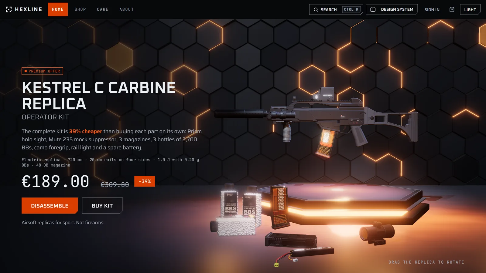
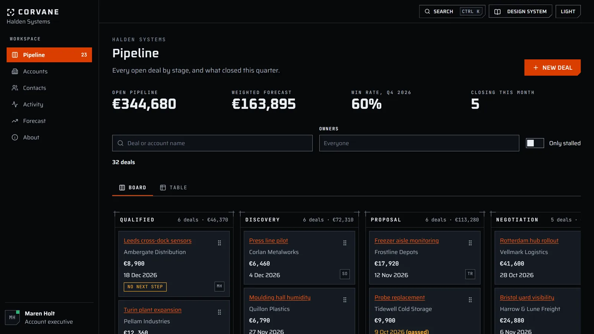
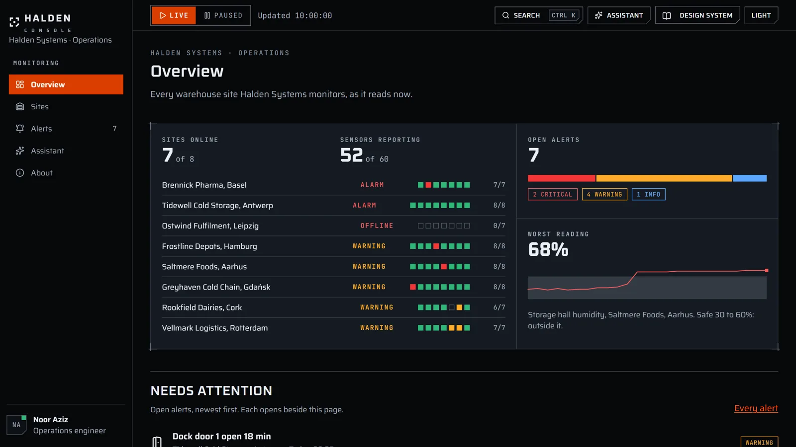
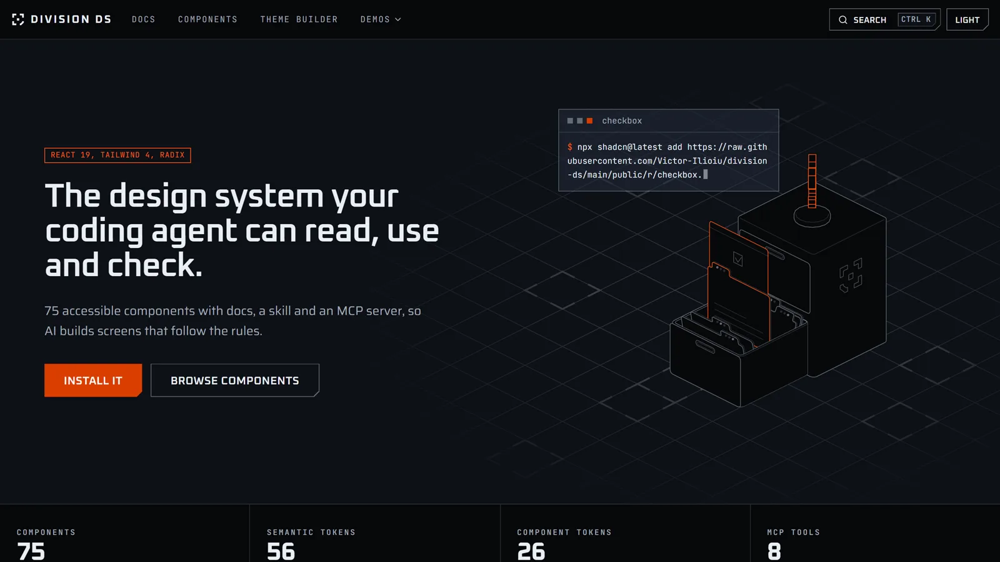

<h1 align="center">Division DS</h1>

<p align="center">
  <b>The design system your coding agent can read, use and check.</b><br>
  Dense, dark interfaces: one loud orange, hairline panels, cut corners, big numbers.
</p>

<p align="center">
  <a href="https://www.npmjs.com/package/division-ds"></a>
  
  
  
  <a href="LICENSE"></a>
</p>

<p align="center">
  
  
  
  
  
</p>

<p align="center">
  <a href="https://victor-ilioiu.vercel.app/systems/division-ds/"><b>Documentation</b></a> ·
  <a href="https://victor-ilioiu.vercel.app/systems/division-ds/components"><b>Components</b></a> ·
  <a href="https://victor-ilioiu.vercel.app/systems/division-ds/store"><b>Hexline demo</b></a> ·
  <a href="https://victor-ilioiu.vercel.app/systems/division-ds/crm"><b>CRM demo</b></a> ·
  <a href="https://victor-ilioiu.vercel.app/systems/division-ds/console"><b>Console demo</b></a> ·
  <a href="CHANGELOG.md"><b>Changelog</b></a>
</p>

<p align="center">
  <a href="https://victor-ilioiu.vercel.app/systems/division-ds/store">
    
  </a>
</p>

<p align="center"><sub>Hexline, a demo store built only from Division DS components. The replica on the stage is a live three.js scene you can drag.</sub></p>

---

## What's in it

| | |
|---|---|
| **75 React components** | From Button and Select up to DataTable, KanbanBoard, Terminal and a chat thread. Each one is a single file you own. |
| **192 design tokens** | Three layers (primitive, semantic, component) in a light and a dark theme. Components only read semantic tokens, so a theme change needs no component edits. |
| **Accessibility, measured** | WCAG 2.2 AA. 148 colour pairs are measured in both themes on every build, and every component has an automated accessibility test. |
| **A build that says no** | Gates for raw colours, invented token names, touching buttons, stale docs and unknown props. A broken rule fails the build and the message says what to write instead. |
| **Made for coding agents** | A skill, an MCP server, `llms.txt` and a plain-text page per component, so an assistant picks the right component and checks its own work. |

## See it working

Three demo apps share the same components and tokens, and nothing else.

<table>
  <tr>
    <td width="50%"><a href="https://victor-ilioiu.vercel.app/systems/division-ds/crm"></a></td>
    <td width="50%"><a href="https://victor-ilioiu.vercel.app/systems/division-ds/console"></a></td>
  </tr>
  <tr>
    <td align="center"><b>Corvane</b>, a CRM: pipeline board, tables, forms</td>
    <td align="center"><b>Halden Console</b>, live monitoring: status, alerts, charts</td>
  </tr>
  <tr>
    <td colspan="2"><a href="https://victor-ilioiu.vercel.app/systems/division-ds/"></a></td>
  </tr>
  <tr>
    <td colspan="2" align="center"><b>The documentation site</b>: every component with live examples, props, keyboard behaviour, and do and don't</td>
  </tr>
</table>

## Install

There are three ways in. Use the one that fits what you are doing.

### 1. Give your AI coding assistant the skill

The skill teaches an assistant (Claude Code, Cursor, Codex and others) which component and token
to use, the rules the prop types cannot express, and how to check its work.

```bash
npx skills add https://github.com/Victor-Ilioiu/division-ds --skill division-ds
```

In Claude Code you can also install it as a plugin:

```text
/plugin marketplace add Victor-Ilioiu/division-ds
/plugin install division-ds@division-ds
```

Or give it the MCP server, which serves the docs and runs the same checks as tools
(`list_components`, `get_component`, `search`, `get_tokens`, `validate_code`, `check_contrast`,
`get_add_command`, `get_review_checklist`, plus `request_change` and `report_drift`, which file an
issue here instead of patching the installed copy):

```bash
claude mcp add division-ds -- npx -y division-ds@latest mcp
```

### 2. Add components to your own project

Each component installs on its own with the shadcn command line tool. The code is copied into
`src/division-ds/` in your project, where it is yours to change. Anything a component needs, such
as other components, the tokens and the helpers, comes with it.

```bash
npx shadcn@latest add https://raw.githubusercontent.com/Victor-Ilioiu/division-ds/main/public/r/button.json
```

Swap `button` for any component's name in lowercase, with hyphens: `data-table`, `alert-dialog`.
For the whole library in one command, use `division-ds-all`. No `components.json` is needed.
[`registry.json`](https://raw.githubusercontent.com/Victor-Ilioiu/division-ds/main/public/r/registry.json) lists
them all.

<details>
<summary><b>One-time setup in your project</b> (React 19 and Tailwind CSS 4)</summary>

1. In your main CSS file, after `@import "tailwindcss";`, add:
   ```css
   @import "./division-ds/styles/division-ds.css";
   ```
   (Adjust the path if your CSS file is not in `src/`.)
2. Load the three typefaces in your `index.html` `<head>`:
   ```html
   <link rel="preconnect" href="https://fonts.googleapis.com" />
   <link rel="preconnect" href="https://fonts.gstatic.com" crossorigin />
   <link href="https://fonts.googleapis.com/css2?family=Oxanium:wght@300;400;600;700&family=Saira:wght@300;400;500;600;700&family=JetBrains+Mono:wght@400;600&display=swap" rel="stylesheet" />
   ```
3. Dark is the default theme. For light, set `data-theme="light"` on `<html>`.

</details>

Check your screens against the system's rules (raw colours, invented tokens, touching buttons,
unknown props) with `npx division-ds check src`. Node 22 or newer.

### 3. Run the whole thing locally

You need [Git](https://git-scm.com/) and [Node.js](https://nodejs.org/) 22 or newer.

```bash
git clone https://github.com/Victor-Ilioiu/division-ds.git
cd division-ds
npm install
npm run dev
```

Open the address it prints. The documentation is at `/`, and the demos are at `/store`, `/crm`
and `/console`.

| You want to | Run |
|---|---|
| Check everything: types, every build gate, the unit tests | `npm run verify` |
| Run the browser tests | `npm run test:e2e` |
| Build the site | `npm run build` |

## For AI agents

Start with [`AGENTS.md`](AGENTS.md). Every component also has a plain-text page under
`public/docs/components/`, and [`public/llms.txt`](public/llms.txt) indexes them.

## Licence

MIT. See [LICENSE](LICENSE).
